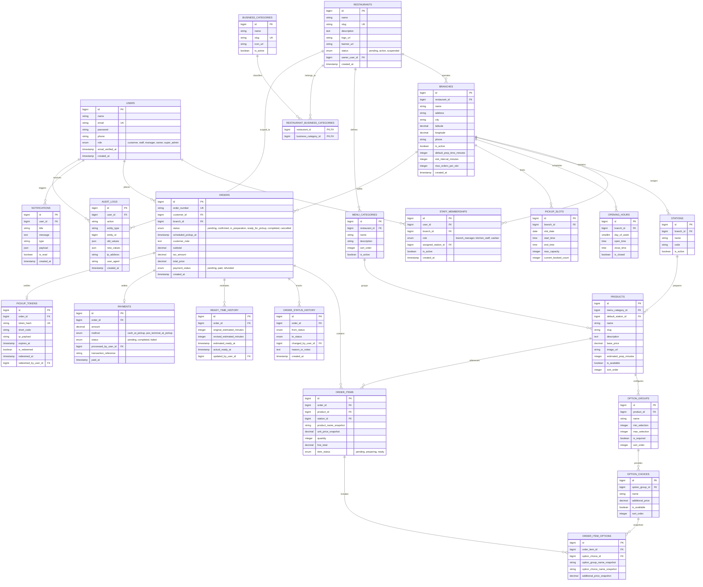

# Arkitektura e Bazës së të Dhënave & Modeli Entitet-Relacion (ERD)

## 1. Përmbledhja e Skemës Relacionale

Baza e të dhënave është ndërtuar mbi **MySQL 8.0 / MariaDB 10.4**, duke zbatuar rreptësisht Formën e Tretë Normale (3NF) për integritet të lartë relacional, indekse të shpejta për çelësat e huaj dhe tabela të pandryshueshme historiku për auditim.

### Standardet Kryesore:
- **Motori:** InnoDB (pajtueshmëri me transaksione ACID, kyçje në nivel rreshti).
- **Kodimi:** `utf8mb4_unicode_ci` (mbështetje e plotë e shkronjave shqipe dhe simboleve).
- **Saktësia Financiare:** Të gjitha fushat monetare ruhen si `DECIMAL(10, 2)` për të parandaluar gabimet e rrumbullakimit.
- **Auditimi & Koha:** Çdo tabelë përmban `created_at` dhe `updated_at`. Ndryshimet e statusit të porosive ruhen në tabelën e pandryshueshme `order_status_history`.
- **Integriteti Referencial:** Çelësa të huaj me `ON DELETE CASCADE` për fëmijët e varur (p.sh. `order_items` -> `order_item_options`) dhe `RESTRICT` për regjistrimet kritike të porosive.

---

## 2. Mermaid Entity-Relationship Diagram

---

## 3. Entity Dictionary & Table Specifications

### 3.1 `users`
Stores all platform actors (Customers, Staff, Managers, Owners, Admins).
- `id`: BIGINT UNSIGNED AUTO_INCREMENT PRIMARY KEY
- `name`: VARCHAR(255) NOT NULL
- `email`: VARCHAR(255) NOT NULL UNIQUE
- `password`: VARCHAR(255) NOT NULL (Bcrypt/Argon2id hash)
- `phone`: VARCHAR(50) NULLABLE
- `role`: ENUM('customer', 'staff', 'manager', 'owner', 'super_admin') DEFAULT 'customer'
- `email_verified_at`: TIMESTAMP NULLABLE
- `created_at`, `updated_at`: TIMESTAMPS

### 3.2 `restaurants`
Top-level business entity (brand/company).
- `id`: BIGINT UNSIGNED AUTO_INCREMENT PRIMARY KEY
- `name`: VARCHAR(255) NOT NULL
- `slug`: VARCHAR(255) NOT NULL UNIQUE
- `description`: TEXT NULLABLE
- `logo_url`: VARCHAR(500) NULLABLE
- `banner_url`: VARCHAR(500) NULLABLE
- `status`: ENUM('pending', 'active', 'suspended') DEFAULT 'pending'
- `owner_user_id`: BIGINT UNSIGNED NOT NULL (FK -> users.id)
- `created_at`, `updated_at`: TIMESTAMPS

### 3.3 `branches`
Physical fulfillment locations owned by a restaurant.
- `id`: BIGINT UNSIGNED AUTO_INCREMENT PRIMARY KEY
- `restaurant_id`: BIGINT UNSIGNED NOT NULL (FK -> restaurants.id ON DELETE CASCADE)
- `name`: VARCHAR(255) NOT NULL (e.g. "Pristina Center", "Dardania")
- `address`: VARCHAR(255) NOT NULL
- `city`: VARCHAR(100) NOT NULL DEFAULT 'Pristina'
- `latitude`: DECIMAL(10, 8) NULLABLE
- `longitude`: DECIMAL(11, 8) NULLABLE
- `phone`: VARCHAR(50) NOT NULL
- `is_active`: BOOLEAN DEFAULT TRUE
- `default_prep_time_minutes`: INT UNSIGNED DEFAULT 25
- `slot_interval_minutes`: INT UNSIGNED DEFAULT 15
- `max_orders_per_slot`: INT UNSIGNED DEFAULT 6
- `created_at`, `updated_at`: TIMESTAMPS

### 3.4 `staff_memberships`
Role assignments tying a staff user to a specific branch.
- `id`: BIGINT UNSIGNED AUTO_INCREMENT PRIMARY KEY
- `user_id`: BIGINT UNSIGNED NOT NULL (FK -> users.id ON DELETE CASCADE)
- `branch_id`: BIGINT UNSIGNED NOT NULL (FK -> branches.id ON DELETE CASCADE)
- `role`: ENUM('branch_manager', 'kitchen_staff', 'cashier') NOT NULL
- `assigned_station_id`: BIGINT UNSIGNED NULLABLE (FK -> stations.id ON DELETE SET NULL)
- `is_active`: BOOLEAN DEFAULT TRUE
- `created_at`, `updated_at`: TIMESTAMPS
- UNIQUE KEY `unique_branch_user` (`branch_id`, `user_id`)

### 3.5 `business_categories` & `restaurant_business_category`
Global cuisine classifications (e.g., Traditional, Pizza, Asian, Bakery).
- `business_categories.id`: BIGINT UNSIGNED AUTO_INCREMENT PRIMARY KEY
- `business_categories.name`: VARCHAR(100) NOT NULL
- `business_categories.slug`: VARCHAR(100) NOT NULL UNIQUE
- `business_categories.icon_url`: VARCHAR(500) NULLABLE
- Pivot table `restaurant_business_category`: (`restaurant_id`, `business_category_id`) composite primary key.

### 3.6 `menu_categories`
Restaurant-specific menu headers (e.g. "Appetizers", "Main Courses", "Desserts").
- `id`: BIGINT UNSIGNED AUTO_INCREMENT PRIMARY KEY
- `restaurant_id`: BIGINT UNSIGNED NOT NULL (FK -> restaurants.id ON DELETE CASCADE)
- `name`: VARCHAR(255) NOT NULL
- `description`: TEXT NULLABLE
- `sort_order`: INT DEFAULT 0
- `is_active`: BOOLEAN DEFAULT TRUE

### 3.7 `products`
The purchasable food & drink catalog items.
- `id`: BIGINT UNSIGNED AUTO_INCREMENT PRIMARY KEY
- `menu_category_id`: BIGINT UNSIGNED NOT NULL (FK -> menu_categories.id ON DELETE CASCADE)
- `default_station_id`: BIGINT UNSIGNED NULLABLE (FK -> stations.id ON DELETE SET NULL)
- `name`: VARCHAR(255) NOT NULL
- `slug`: VARCHAR(255) NOT NULL
- `description`: TEXT NULLABLE
- `base_price`: DECIMAL(10, 2) NOT NULL
- `image_url`: VARCHAR(500) NULLABLE
- `estimated_prep_minutes`: INT DEFAULT 15
- `is_available`: BOOLEAN DEFAULT TRUE
- `sort_order`: INT DEFAULT 0

### 3.8 `option_groups` & `option_choices`
Modifier groups (e.g., "Size", "Sauce", "Extra Toppings") and choices.
- `option_groups.id`: BIGINT UNSIGNED AUTO_INCREMENT PRIMARY KEY
- `option_groups.product_id`: BIGINT UNSIGNED NOT NULL (FK -> products.id ON DELETE CASCADE)
- `option_groups.name`: VARCHAR(255) NOT NULL
- `option_groups.min_selection`: INT DEFAULT 0
- `option_groups.max_selection`: INT DEFAULT 1
- `option_groups.is_required`: BOOLEAN DEFAULT FALSE
- `option_groups.sort_order`: INT DEFAULT 0
- `option_choices.id`: BIGINT UNSIGNED AUTO_INCREMENT PRIMARY KEY
- `option_choices.option_group_id`: BIGINT UNSIGNED NOT NULL (FK -> option_groups.id ON DELETE CASCADE)
- `option_choices.name`: VARCHAR(255) NOT NULL
- `option_choices.additional_price`: DECIMAL(10, 2) DEFAULT 0.00
- `option_choices.is_available`: BOOLEAN DEFAULT TRUE

### 3.9 `stations`
Kitchen physical workstations for ticket splitting.
- `id`: BIGINT UNSIGNED AUTO_INCREMENT PRIMARY KEY
- `branch_id`: BIGINT UNSIGNED NOT NULL (FK -> branches.id ON DELETE CASCADE)
- `name`: VARCHAR(100) NOT NULL (e.g., "Grill", "Salad Bar", "Packaging", "Drinks")
- `code`: VARCHAR(50) NOT NULL
- `is_active`: BOOLEAN DEFAULT TRUE

### 3.10 `opening_hours`
7-day branch operating schedule.
- `id`: BIGINT UNSIGNED AUTO_INCREMENT PRIMARY KEY
- `branch_id`: BIGINT UNSIGNED NOT NULL (FK -> branches.id ON DELETE CASCADE)
- `day_of_week`: TINYINT NOT NULL (0 = Sunday, 1 = Monday, ... 6 = Saturday)
- `open_time`: TIME NOT NULL
- `close_time`: TIME NOT NULL
- `is_closed`: BOOLEAN DEFAULT FALSE

### 3.11 `pickup_slots`
Dynamic capacity tracking per branch and time window.
- `id`: BIGINT UNSIGNED AUTO_INCREMENT PRIMARY KEY
- `branch_id`: BIGINT UNSIGNED NOT NULL (FK -> branches.id ON DELETE CASCADE)
- `slot_date`: DATE NOT NULL
- `start_time`: TIME NOT NULL
- `end_time`: TIME NOT NULL
- `max_capacity`: INT NOT NULL DEFAULT 6
- `current_booked_count`: INT NOT NULL DEFAULT 0
- UNIQUE KEY `unique_branch_slot` (`branch_id`, `slot_date`, `start_time`)

### 3.12 `orders`
Master order record.
- `id`: BIGINT UNSIGNED AUTO_INCREMENT PRIMARY KEY
- `order_number`: VARCHAR(50) NOT NULL UNIQUE (e.g. `ORD-20261110-8X42`)
- `customer_id`: BIGINT UNSIGNED NOT NULL (FK -> users.id)
- `branch_id`: BIGINT UNSIGNED NOT NULL (FK -> branches.id)
- `status`: ENUM('pending', 'confirmed', 'in_preparation', 'ready_for_pickup', 'completed', 'cancelled') DEFAULT 'pending'
- `scheduled_pickup_at`: TIMESTAMP NOT NULL
- `customer_note`: TEXT NULLABLE
- `subtotal`: DECIMAL(10, 2) NOT NULL
- `tax_amount`: DECIMAL(10, 2) DEFAULT 0.00
- `total_price`: DECIMAL(10, 2) NOT NULL
- `payment_status`: ENUM('pending', 'paid', 'refunded') DEFAULT 'pending'
- `created_at`, `updated_at`: TIMESTAMPS

### 3.13 `order_items` & `order_item_options`
Purchased items with point-in-time price snapshots.
- `order_items.id`: BIGINT UNSIGNED AUTO_INCREMENT PRIMARY KEY
- `order_items.order_id`: BIGINT UNSIGNED NOT NULL (FK -> orders.id ON DELETE CASCADE)
- `order_items.product_id`: BIGINT UNSIGNED NOT NULL
- `order_items.station_id`: BIGINT UNSIGNED NULLABLE (FK -> stations.id ON DELETE SET NULL)
- `order_items.product_name_snapshot`: VARCHAR(255) NOT NULL
- `order_items.unit_price_snapshot`: DECIMAL(10, 2) NOT NULL
- `order_items.quantity`: INT NOT NULL DEFAULT 1
- `order_items.line_total`: DECIMAL(10, 2) NOT NULL
- `order_items.item_status`: ENUM('pending', 'preparing', 'ready') DEFAULT 'pending'
- `order_item_options.id`: BIGINT UNSIGNED AUTO_INCREMENT PRIMARY KEY
- `order_item_options.order_item_id`: BIGINT UNSIGNED NOT NULL (FK -> order_items.id ON DELETE CASCADE)
- `order_item_options.option_choice_id`: BIGINT UNSIGNED NOT NULL
- `order_item_options.option_group_name_snapshot`: VARCHAR(255) NOT NULL
- `order_item_options.option_choice_name_snapshot`: VARCHAR(255) NOT NULL
- `order_item_options.additional_price_snapshot`: DECIMAL(10, 2) NOT NULL

### 3.14 `order_status_history` & `ready_time_history`
Append-only state audit trails.
- `order_status_history`: Tracks each transition (`from_status`, `to_status`, `changed_by_user_id`, `reason_or_notes`, `created_at`).
- `ready_time_history`: Logs estimated vs actual ready times (`original_estimated_minutes`, `revised_estimated_minutes`, `estimated_ready_at`, `actual_ready_at`, `updated_by_user_id`).

### 3.15 `pickup_tokens` & `payments`
Secure fulfillment and settlement.
- `pickup_tokens`: `order_id`, `token_hash` (SHA-256), `short_code` (6-char alphanumeric), `qr_payload`, `expires_at`, `is_redeemed`, `redeemed_at`, `redeemed_by_user_id`.
- `payments`: `order_id`, `amount`, `method` ('cash_at_pickup', 'pos_terminal_at_pickup'), `status` ('pending', 'completed', 'failed'), `processed_by_user_id`, `transaction_reference`, `paid_at`.

### 3.16 `notifications` & `audit_logs`
- `notifications`: User-facing real-time notifications with JSON payloads.
- `audit_logs`: Detailed tracking of administrative operations, old values, new values, IP, and user-agent.
